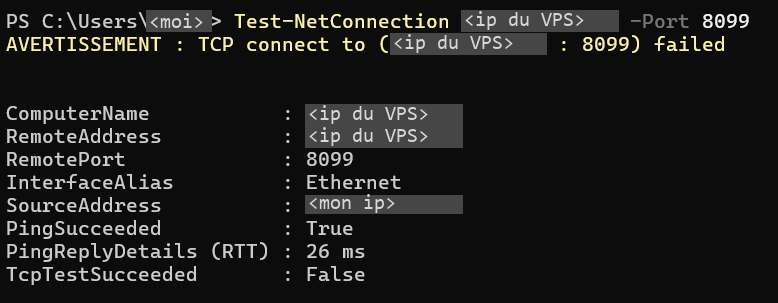

# Les règles DOCKER-USER qui ne bloquaient rien

Le VPS de notre serveur minecraft refuse tout en entrée avec UFW, sauf les ports utiles, et le panel Pterodactyl y fait tourner les serveurs minecraft dans des conteneurs Docker. Quand j'ai installé la machine, c'était mon premier serveur et je ne savais pas vraiment ce qu'était Docker. J'avais appris à ce moment-là que Docker contourne UFW pour les ports qu'il publie, et j'avais posé des règles dans la chaîne `DOCKER-USER` pour corriger ça. Mes notes d'infra disaient depuis que UFW s'appliquait aussi aux ports des conteneurs. En octobre, en préparant le [script d'audit](../durcissement/) de la machine, j'ai relu ces règles pour la première fois depuis l'installation.

---

## Pourquoi Docker passe devant UFW

Un conteneur a sa propre adresse sur un réseau privé interne au VPS, du genre `172.17.0.2`, injoignable depuis internet. Pour qu'un joueur l'atteigne, Docker publie un port, c'est-à-dire qu'il réécrit la destination des paquets qui arrivent sur ce port de la machine pour les envoyer au conteneur. C'est un DNAT, fait dans la table `nat` en `PREROUTING`, avant tout filtrage.

Le paquet réécrit n'est plus destiné à la machine mais au conteneur, donc il passe par la chaîne `FORWARD` et pas par `INPUT`, où UFW filtre le trafic entrant. UFW a aussi des règles dans `FORWARD`, mais Docker place ses sauts avant les siennes et accepte les ports publiés avant qu'UFW ne les voie. Le seul endroit où l'administrateur peut refuser un paquet avant Docker est la chaîne `DOCKER-USER`, en tête de `FORWARD`.

---

## Ce que contenait ma chaîne

```
$ sudo iptables -S DOCKER-USER
-N DOCKER-USER
-A DOCKER-USER -j ufw-user-forward
-A DOCKER-USER -s 10.0.0.0/8 -j RETURN
-A DOCKER-USER -s 172.16.0.0/12 -j RETURN
-A DOCKER-USER -s 192.168.0.0/16 -j RETURN
```

La première ligne envoie le paquet vers les règles `ufw route allow`, et les trois suivantes laissent repartir ce qui vient d'un réseau privé, pour que les conteneurs se parlent entre eux. Aucune ligne ne refuse quoi que ce soit. Un paquet venu d'internet arrive au bout de la chaîne sans verdict, retourne dans `FORWARD`, et les chaînes de Docker l'acceptent.

Les règles venaient de `/etc/ufw/after.rules`, que UFW charge à chaque démarrage :

```
$ sudo grep -n -A25 "DOCKER-USER" /etc/ufw/after.rules
36::DOCKER-USER - [0:0]
37:-A DOCKER-USER -j ufw-user-forward
38-
39:-A DOCKER-USER -j RETURN -s 10.0.0.0/8
40:-A DOCKER-USER -j RETURN -s 172.16.0.0/12
41:-A DOCKER-USER -j RETURN -s 192.168.0.0/16
42-
43--A ufw-docker-logging-deny -m limit --limit 3/min --limit-burst 10 -j LOG --log-prefix "[UFW DOCKER BLOCK] "
44--A ufw-docker-logging-deny -j DROP
45-
46-COMMIT
47-# END UFW AND DOCKER
```

C'est le bloc du projet ufw-docker avec un trou au milieu. La chaîne `ufw-docker-logging-deny`, qui note la tentative dans le journal puis jette le paquet, est bien définie aux lignes 43 et 44, mais les lignes qui devaient lui envoyer les nouvelles connexions vers les conteneurs manquaient entre les lignes 41 et 43. Je ne sais pas à quel moment elles ont été perdues.

Les services de la machine elle-même, comme SSH, le panel ou le SFTP de Wings, passent par `INPUT` et restaient filtrés par UFW. Le seul conteneur publiait les ports du jeu, du textures pack et du vocal, qui doivent de toute façon être ouverts :

```
$ sudo docker ps --format '{{.Names}}  {{.Ports}}'
<serveur>  <ip>:25565-25566->25565-25566/tcp, <ip>:25565-25566->25565-25566/udp
```

Mais ce qui décidait de ce qui était ouvert sur les conteneurs, c'était uniquement la liste des allocations du panel. Une allocation ajoutée pour un test, une console RCON ou une carte web aurait été joignable depuis le monde entier, alors qu'UFW la donnait pour fermée.

---

## Le voir depuis l'extérieur

J'ai lancé un conteneur jetable qui publie le port 8099, qu'aucune règle d'UFW n'autorise, puis je l'ai testé depuis mon PC, donc depuis internet :

```bash
sudo docker run -d --rm --name test-ufw -p 8099:80 nginx:alpine
```

```powershell
Test-NetConnection <ip du VPS> -Port 8099
```

Le test a répondu `TcpTestSucceeded : True`, ce qui confirmait de l'extérieur ce que la lecture de la chaîne laissait prévoir.

---

## La correction

Comme `ufw-user-forward` était vide, ajouter les refus d'abord aurait coupé le jeu. J'ai donc sauvegardé `after.rules` et l'état complet d'iptables, puis autorisé les ports du serveur minecraft :

```bash
sudo ufw route allow proto tcp from any to any port 25565:25566 comment 'jeu et pack'
sudo ufw route allow proto udp from any to any port 25565:25566 comment 'vocal'
```

J'ai ensuite remis les lignes manquantes du bloc juste après la ligne 41, avec `sed` et un fichier temporaire pour ne rien retaper à la main, puis redémarré UFW.

```
-A DOCKER-USER -p udp -m udp --sport 53 --dport 1024:65535 -j RETURN

-A DOCKER-USER -j ufw-docker-logging-deny -p tcp -m tcp --tcp-flags FIN,SYN,RST,ACK SYN -d 192.168.0.0/16
-A DOCKER-USER -j ufw-docker-logging-deny -p tcp -m tcp --tcp-flags FIN,SYN,RST,ACK SYN -d 10.0.0.0/8
-A DOCKER-USER -j ufw-docker-logging-deny -p tcp -m tcp --tcp-flags FIN,SYN,RST,ACK SYN -d 172.16.0.0/12
-A DOCKER-USER -j ufw-docker-logging-deny -p udp -m udp --dport 0:32767 -d 192.168.0.0/16
-A DOCKER-USER -j ufw-docker-logging-deny -p udp -m udp --dport 0:32767 -d 10.0.0.0/8
-A DOCKER-USER -j ufw-docker-logging-deny -p udp -m udp --dport 0:32767 -d 172.16.0.0/12

-A DOCKER-USER -j RETURN
```

La première ligne laisse passer les réponses DNS que reçoivent les conteneurs. Les lignes TCP ne refusent que les paquets qui ouvrent une connexion, ceux qui n'ont que le drapeau SYN, donc les réponses aux connexions que le serveur ouvre lui-même passent toujours. Les lignes UDP font la même chose pour les ports bas, ce qui couvre le vocal. Les ports autorisés juste avant passent par `ufw-user-forward`, lu en premier, et le reste est jeté.

---

## La vérification

UFW est reparti actif, et la chaîne contient maintenant ses refus :

```
$ sudo iptables -S DOCKER-USER
-N DOCKER-USER
-A DOCKER-USER -j ufw-user-forward
-A DOCKER-USER -s 10.0.0.0/8 -j RETURN
-A DOCKER-USER -s 172.16.0.0/12 -j RETURN
-A DOCKER-USER -s 192.168.0.0/16 -j RETURN
-A DOCKER-USER -p udp -m udp --sport 53 --dport 1024:65535 -j RETURN
-A DOCKER-USER -d 192.168.0.0/16 -p tcp -m tcp --tcp-flags FIN,SYN,RST,ACK SYN -j ufw-docker-logging-deny
-A DOCKER-USER -d 10.0.0.0/8 -p tcp -m tcp --tcp-flags FIN,SYN,RST,ACK SYN -j ufw-docker-logging-deny
-A DOCKER-USER -d 172.16.0.0/12 -p tcp -m tcp --tcp-flags FIN,SYN,RST,ACK SYN -j ufw-docker-logging-deny
-A DOCKER-USER -d 192.168.0.0/16 -p udp -m udp --dport 0:32767 -j ufw-docker-logging-deny
-A DOCKER-USER -d 10.0.0.0/8 -p udp -m udp --dport 0:32767 -j ufw-docker-logging-deny
-A DOCKER-USER -d 172.16.0.0/12 -p udp -m udp --dport 0:32767 -j ufw-docker-logging-deny
-A DOCKER-USER -j RETURN
```

Le redémarrage d'UFW n'avait pas touché aux sauts de Docker dans `FORWARD`, sans lesquels les conteneurs seraient devenus injoignables :

```
$ sudo iptables -S FORWARD
-P FORWARD DROP
-A FORWARD -j DOCKER-USER
-A FORWARD -j DOCKER-FORWARD
-A FORWARD -j ufw-before-logging-forward
[...]
```

Depuis mon PC, le port 8099 ne répondait plus, et le journal du noyau a noté chaque tentative :



```
$ sudo journalctl -k --since "10 min ago" | grep "UFW DOCKER BLOCK" | tail -5
16:41:43 [UFW DOCKER BLOCK] IN=eth0 OUT=docker0 SRC=<mon ip> DST=172.17.0.2 PROTO=TCP SPT=49072 DPT=80 [...] SYN
16:41:44 [UFW DOCKER BLOCK] IN=eth0 OUT=docker0 SRC=<mon ip> DST=172.17.0.2 PROTO=TCP SPT=49072 DPT=80 [...] SYN
16:41:46 [UFW DOCKER BLOCK] IN=eth0 OUT=docker0 SRC=<mon ip> DST=172.17.0.2 PROTO=TCP SPT=49072 DPT=80 [...] SYN
16:41:50 [UFW DOCKER BLOCK] IN=eth0 OUT=docker0 SRC=<mon ip> DST=172.17.0.2 PROTO=TCP SPT=49072 DPT=80 [...] SYN
16:41:58 [UFW DOCKER BLOCK] IN=eth0 OUT=docker0 SRC=<mon ip> DST=172.17.0.2 PROTO=TCP SPT=49072 DPT=80 [...] SYN
```

Le port de destination noté est 80, celui du conteneur, alors que mon PC visait le 8099, parce que le DNAT a déjà eu lieu quand le paquet arrive dans `DOCKER-USER`. Une règle écrite avec `--dport 8099` n'aurait donc jamais rien bloqué, et pour filtrer sur le port publié il faut demander le port d'origine à conntrack avec `-m conntrack --ctorigdstport`. Les tentatives sont aussi espacées de 1, 2, 4 puis 8 secondes : un `DROP` ne répond rien, donc mon PC renvoyait sa demande en doublant l'attente, alors qu'un `REJECT` lui aurait répondu tout de suite que le port était fermé.

Côté joueurs, rien n'a changé : je me suis connecté au serveur, le textures pack s'est téléchargé et le vocal fonctionnait. J'ai retiré le conteneur de test avec `sudo docker rm -f test-ufw`. Désormais, chaque nouveau port de conteneur demande sa propre ligne `ufw route allow`, sinon il reste fermé même s'il est alloué dans le panel.

---

La chaîne qui note et jette les paquets était définie, mais aucune ligne ne lui envoyait le trafic, et rien ne le signalait puisque tout fonctionnait. Mes notes affirmaient une protection que personne n'avait vérifiée depuis l'installation, et il a fallu relire la chaîne ligne par ligne pour le voir.
