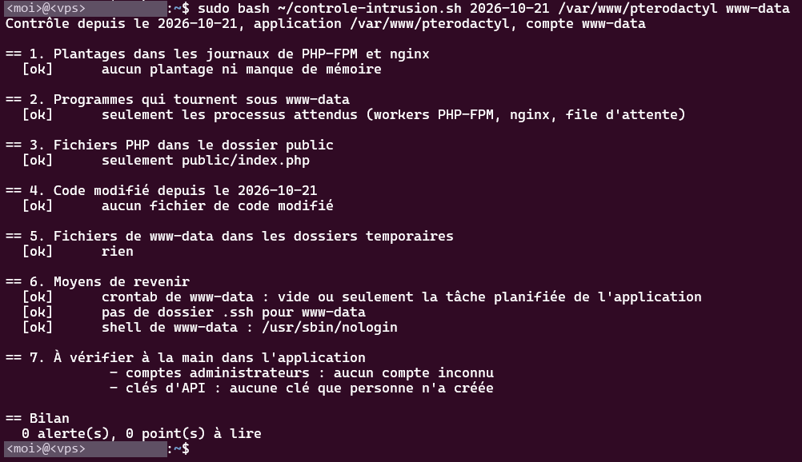

# PHP2Shell : mise à jour et contrôle de compromission d'un panel exposé

Le 22 octobre 2026, j'ai vu passer l'annonce de deux failles critiques dans PHP, publiées la veille. Je voulais savoir si la machine était concernée, puis si quelqu'un en avait profité avant ma mise à jour.

---

## La machine est-elle touchée

CVE-2026-109618 et CVE-2026-109619, surnommées PHP2Shell, sont notées 9.2 en CVSS v4 et permettent une remote code execution sans compte sur toute installation PHP qui sert des requêtes web (PHP-FPM, mod_php, FrankenPHP). Elles se trouvent dans le code qui lit la requête entrante, avant que l'application s'exécute, donc une application sans bug à elle est exposée quand même.

Le site tourne en Next.js et ne contient aucun fichier PHP. Le panel Pterodactyl, en revanche, tourne sous PHP-FPM derrière nginx, il est ouvert sur internet, et mes notes d'infra le donnaient dans une version de la branche 8.3 antérieure au correctif. Comme il gère les conteneurs des serveurs minecraft et leurs fichiers, prendre la main dessus revient à prendre la main sur le serveur.

La première faille fait manquer de mémoire PHP pendant qu'il lit une requête multipart fabriquée. PHP s'interrompt en laissant des structures à moitié initialisées, que le nettoyage traite ensuite comme valides, ce qui corrompt la mémoire. Sous PHP-FPM, le worker est tué si l'erreur arrive très tôt, et aucune attaque complète contre FPM n'était publiée au moment des faits.

La seconde concernait directement le panel. Un worker PHP-FPM sert plusieurs requêtes à la suite, et si une erreur fatale ou un timeout coupe le nettoyage entre deux requêtes, une référence reste vers de la mémoire déjà libérée, ce qu'on appelle un use-after-free. La requête suivante peut alors lire des mots de passe ou des jetons d'autres utilisateurs, voire exécuter du code. La voie publiée passe par le suivi de progression des uploads (`session.upload_progress`).

---

## La mise à jour

Les articles ne s'accordaient pas sur la disponibilité du correctif dans le dépôt tiers que j'utilise pour PHP, donc j'ai d'abord regardé ce qu'apt proposait.

```bash
sudo apt update && apt list --upgradable
sudo apt upgrade
```

La version corrigée était bien là :

```
$ sudo systemctl restart php8.3-fpm && systemctl is-active php8.3-fpm nginx && php -v
active
active
PHP 8.3.36 (cli) (built: Oct 21 2026 08:22:00) (NTS)
Copyright (c) The PHP Group
Zend Engine v4.3.36, Copyright (c) Zend Technologies
    with Zend OPcache v8.3.36, Copyright (c), by Zend Technologies
```

`php -v` donne la version de PHP en ligne de commande et pas celle du binaire PHP-FPM qui sert le panel, donc la vérification exacte est `php-fpm8.3 -v`. Si le correctif n'avait pas encore été publié, j'avais prévu de passer `session.upload_progress.enabled` à `0` dans le `php.ini` de FPM, une fonction que le panel n'utilise pas, pour fermer la voie publiée de la seconde faille en attendant.

---

## Est-ce que quelqu'un est passé avant moi

Le panel est resté exposé environ une journée. Il tourne sous le compte système `www-data`, donc du code injecté par la faille aurait pu lire et modifier ses fichiers, dont le `.env` qui contient le mot de passe de la base et la clé de l'application, sans devenir root pour autant. J'ai cherché les traces de chaque étape d'une attaque.

### Les essais

Corrompre la mémoire d'un processus le fait souvent planter, et le noyau le tue alors avec un signal 11 (SIGSEGV). Les messages `Allowed memory size` signalent PHP à court de mémoire, le point de départ de la première faille. `zgrep` lit aussi les journaux déjà compressés par la rotation.

```bash
sudo zgrep -iE 'signal (11|7|6)|SIGSEGV|SIGBUS|Allowed memory size' /var/log/php8.3-fpm.log* /var/log/nginx/*error.log*
```

Il n'y avait aucune série de `exited on signal 11` après le 21.

### Une intrusion réussie

Sous `www-data`, je ne devais trouver que les workers PHP-FPM, ceux de nginx et la file d'attente du panel (`artisan queue:work`). Un `sh`, un `curl` ou un chemin dans `/tmp` aurait trahi un programme lancé par un attaquant.

```bash
ps -u www-data -o pid,lstart,cmd
```

Un webshell est un fichier PHP déposé par l'attaquant, qu'il appelle ensuite depuis son navigateur pour lancer des commandes. Le dossier public du panel ne doit contenir que `index.php`. J'ai aussi listé le code modifié depuis le 21, hors cache et journaux, puis les fichiers de `www-data` dans les dossiers où tout le monde peut écrire.

```bash
sudo find /var/www/pterodactyl/public -name "*.php"
sudo find /var/www/pterodactyl -newermt "2026-10-21" -type f -not -path "*/storage/*" -not -path "*/bootstrap/cache/*"
sudo find /tmp /var/tmp /dev/shm -user www-data -type f
```

### Les moyens de revenir

Une tâche planifiée ou une clé SSH posée dans `/var/www`, le dossier personnel de `www-data`, permettrait à un attaquant de revenir. La seule tâche attendue est `artisan schedule:run`, et le dossier `.ssh` ne doit pas exister.

```bash
sudo crontab -u www-data -l
sudo ls -la /var/www/.ssh
```

Dans l'administration du panel, j'ai enfin vérifié qu'aucun compte administrateur ni aucune clé d'Application API inconnus n'étaient apparus.

---

## Le résultat

Aucune de ces vérifications n'a rien montré de suspect. Elles repèrent les traces des attaques automatiques, celles des robots qui balaient internet à la recherche de serveurs pas encore à jour, ce qui était le scénario le plus probable. Un attaquant soigneux aurait pu effacer les siennes, donc ce résultat écarte ce scénario sans prouver que personne n'est passé. En cas de ligne suspecte, je n'aurais rien supprimé, j'aurais gardé les sorties comme preuves et changé tous les secrets que `www-data` pouvait lire.

Ces vérifications sont regroupées dans un script en lecture seule, [`controle-intrusion.sh`](controle-intrusion.sh) :

```bash
sudo ./controle-intrusion.sh 2026-10-21 /var/www/pterodactyl www-data
```



---

Le panel n'avait aucun bug à lui, la faille était dans PHP, et ce n'était pas le service auquel je pensais en posant ma question sur le site. Le contrôle écarte les attaques automatiques de la journée d'exposition, sans pouvoir exclure une intrusion plus discrète qui aurait effacé ses traces.

## Sources

- [CERT-FR, Multiples vulnérabilités dans PHP (CERTFR-2026-ALE-014)](https://cert.cyber.gouv.fr/alerte/CERTFR-2026-ALE-014/)
- [Cybermalveillance.gouv.fr, AlerteCyber : failles critiques dans PHP](https://www.cybermalveillance.gouv.fr/tous-nos-contenus/actualites/alerte-cyber-failles-de-securite-critiques-dans-php-202610)
- [CISA, Critical Vulnerabilities in PHP Require Immediate Patching](https://www.cisa.gov/news-events/alerts/2026/10/21/critical-vulnerabilities-php-require-immediate-patching)
- [Rapid7, CVE-2026-109618 and CVE-2026-109619](https://www.rapid7.com/blog/post/etr-cve-2026-109618-and-cve-2026-109619-critical-unauthenticated-remote-code-execution-in-php/)
- [Help Net Security, PHP2Shell vulnerabilities patched](https://helpnetsecurity.com/2026/10/21/php2shell-php-vulnerabilities-patched-cve-2026-109618-cve-2026-109619)
